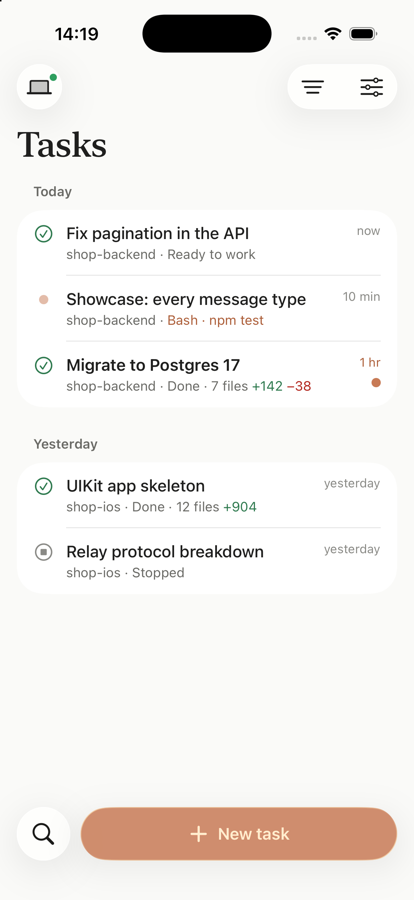
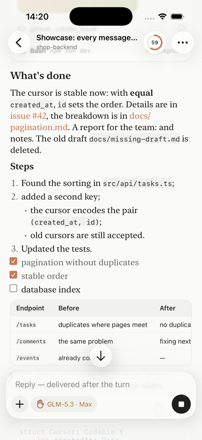

  

<h1 align="center">Ponchik for Mac</h1>

  A native home for AI coding agents on your Mac, with your iPhone as the remote.

  <a href="https://github.com/gre4ixin/ponchik-mac/releases/latest"><b>Download for macOS</b></a>
  &nbsp;·&nbsp;
  <a href="https://ponchik-app.netlify.app">Website</a>
  &nbsp;·&nbsp;
  <a href="https://ponchik-app.netlify.app/support/">Support</a>
  &nbsp;·&nbsp;
  <a href="#по-русски">По-русски</a>

---

Ponchik runs coding agents on your own Mac: they read your project, run commands, edit files and ask you when it matters. You follow along in a fast, native AppKit window, or from the iPhone app when you step away. No account, no cloud of ours: the agent, your code and your conversations stay on your Mac.

  
  &nbsp;&nbsp;
  

## What it does

- **A live feed of the work.** Answers stream in, every command, edit and file read is a card you can open, diffs show inline, plans tick off as the agent goes, and a background subagent's report arrives as a card of its own.
- **You stay in charge.** Pick how much the agent may do: ask before changes, plan first and approve the plan, full access, or **Auto**, where a small model checks each command and only the risky ones ask you. An optional shell sandbox keeps commands inside the project and your secrets unreadable.
- **Talk to it while it works.** A message sent mid-turn reaches the agent at its next step, the way Claude Code does it; ⌘↩ queues it for after the turn instead.
- **Long jobs without babysitting.** Background commands, wake-ups the agent sets for itself, and watches on a build's output that bring the agent back the moment an error shows up.
- **Everything at hand.** Project files, diffs, a terminal, a browser and the iOS Simulator in a side pane; the agent can use them too, and drive apps you allow it to.
- **Your models.** Z.AI's GLM Coding Plan works out of the box; other providers and MCP servers plug in from Settings. Light chores (titles, quick searches) go to a small model so the main one keeps its budget.
- **Your iPhone as the remote.** Scan a QR code once and the phone talks to your Mac directly, end-to-end encrypted: follow tasks, answer questions, approve commands and start new tasks from anywhere on your network. Notifications are encrypted with a key only your phone has.

## Install

1. Download `Ponchik-<version>.dmg` from the [latest release](https://github.com/gre4ixin/ponchik-mac/releases/latest).
2. Open it and drag **Ponchik** to **Applications**. The app is signed with Developer ID and notarized by Apple.
3. Launch it. The first run sets up the agent engine and asks you to connect a model provider.

**Requires** macOS 26 (Tahoe) or later on Apple silicon.

### The iPhone app

Get **Ponchik** from the App Store, then on the Mac open **Settings → iPhone and iPad** and scan the QR code with the phone. Both devices need to be on the same network. No Mac at hand? The iPhone app has a demo on its first screen.

## Privacy

Ponchik has no accounts, analytics or ads. The agent runs on your Mac and talks only to the model provider you chose. The phone connects straight to your Mac; the only thing that passes through our server is a push notification, and its content is encrypted for your phone. See the [privacy policy](https://ponchik-app.netlify.app/privacy/).

## Feedback

Found a bug or want a feature? [Open an issue](https://github.com/gre4ixin/ponchik-mac/issues). This repository holds releases and documentation; the app's source is not published here.

---

## По-русски

**Ponchik для Mac** — нативное приложение для AI-агентов, которые пишут код на вашем Mac, а iPhone служит пультом. Агент читает проект, запускает команды, правит файлы и спрашивает вас, когда это важно. Аккаунта нет, нашего облака тоже: агент, код и переписка остаются на вашем Mac.

- **Живая лента работы:** ответы, команды, правки с диффом, план с отметками, отчёты субагентов карточками.
- **Вы решаете, сколько можно агенту:** спрашивать перед изменениями, сначала план, полный доступ или «Авто», где лёгкая модель проверяет каждую команду и спрашивает только о рискованном. По желанию — песочница для команд.
- **Можно писать по ходу работы:** сообщение доходит до агента на следующем шаге, ⌘↩ ставит его в очередь на после хода.
- **Долгие задачи без присмотра:** фоновые команды, будильники агента и слежение за выводом сборки.
- **Всё под рукой:** файлы, дифф, терминал, браузер и симулятор iOS в боковой панели.
- **Свои модели:** GLM Coding Plan от Z.AI из коробки, другие провайдеры и MCP-серверы — в настройках.
- **iPhone как пульт:** один раз отсканировать QR-код, и телефон говорит с Mac напрямую, с шифрованием.

**Установка:** скачайте DMG из [последнего релиза](https://github.com/gre4ixin/ponchik-mac/releases/latest), перетащите Ponchik в «Программы» и запустите. Нужна macOS 26 или новее на Apple silicon. Приложение для iPhone — в App Store; подключение: на Mac «Настройки → iPhone и iPad», отсканировать QR-код.
